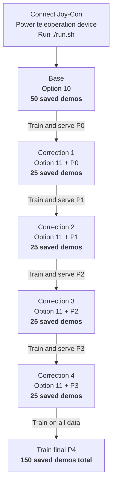

# Franka Experiment Guide

For robot setup or troubleshooting, see [FRANKA.md](FRANKA.md). For a
step-by-step correction session, see the
[Correction Experiment Guide](CORRECTION_EXPERIMENT_GUIDE.md).

## What to collect

The table below is a 50-base-demo example schedule, not the paper's main
Franka evaluation setup. Mug Hanging and Peg Insertion in the paper each use
100 base demonstrations. Set the base count for your experiment before
collection; the correction budget below is 25 saved episodes per round.

| Phase | Option | Policy running | Save |
|-------|--------|----------------|------|
| Base | 10 | None | 50 demos |
| Correction 1 | 11 | Base policy `P0` | 25 demos |
| Correction 2 | 11 | Round-1 policy `P1` | 25 demos |
| Correction 3 | 11 | Round-2 policy `P2` | 25 demos |
| Correction 4 | 11 | Round-3 policy `P3` | 25 demos |

Only saved episodes count toward these training budgets. With the default
success-only recording, failed attempts are discarded. Train the next policy
between correction rounds on the base demonstrations and all corrections so far.

## Experiment flow



For every demo: **B** homes and starts recording, then press **A** to save or
**Y** to discard. Safely reset and repeat. Only **A** increases the saved count.

## Start

1. Clear the workcell and Franka's path to home. Keep the E-stop within reach.

2. Connect the blue Right Joy-Con:

   ```bash
   cd /path/to/I3L
   ./connect.sh
   ```

3. Power on the teleoperation device.

4. **Option 11 only:** run the previous round's policy in another terminal:

   ```bash
   cd /path/to/il_lib
   conda activate behavior
   python serve.py arch=dp_franka robot=franka_iiil \
       task=real/base ckpt_path=/absolute/path/to/checkpoint.pth
   ```

   Use the checkpoint trained in the previous round and leave this running.
   Option 11 does not start inference by itself.

5. Stage the task, leave the workcell, and run `./run.sh`. Choose Option 10 for
   Base or Option 11 for Corrections. Use a new HDF5 filename for every phase.

## Buttons

| Button | Action |
|--------|--------|
| B or Home | Go home, then automatically start recording |
| X | Start recording now without going home |
| A | Save the demo |
| Y | Discard the demo |
| Plus (+) | Finish collection and go home |
| R / ZR | Close / open the gripper |

Normally, start with B. Do not press X afterward.

## Run one demo

1. Safely stage the task and clear the home path.
2. Tap B once. Wait for `RECORDING`.
3. Run:
   - **Option 10:** teleoperate the full task.
   - **Option 11:** let the policy run. Touch and move the teleoperation device
     to correct it; release the device when the policy can resume.
4. Press A to save, or Y to discard.
5. Wait for `READY`, safely reset, and repeat.

Stop at the planned base count (**50** in this example, **100** for the paper's
Franka tasks) or **25 saved** for each correction round. Also
record the `with takeover` count shown during corrections.

## Finish

After the final A or Y, clear the home path and press Plus. Wait for the program
to exit. After Option 11, stop the inference server with Ctrl+C.

## Safety

- `READY` means recording is off, but robot control is still live. Use the
  approved safe reset procedure; never enter the live workcell.
- Option 11 may move before recording starts. Be ready from launch.
- Never press B during recording. If it happens, press Y to discard.
- B and Plus go home without collision planning. Clear the path first.
- Use the physical E-stop for unsafe motion. JoyCon buttons are not an E-stop.
